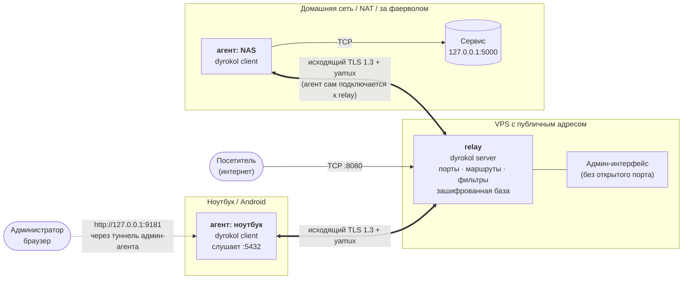
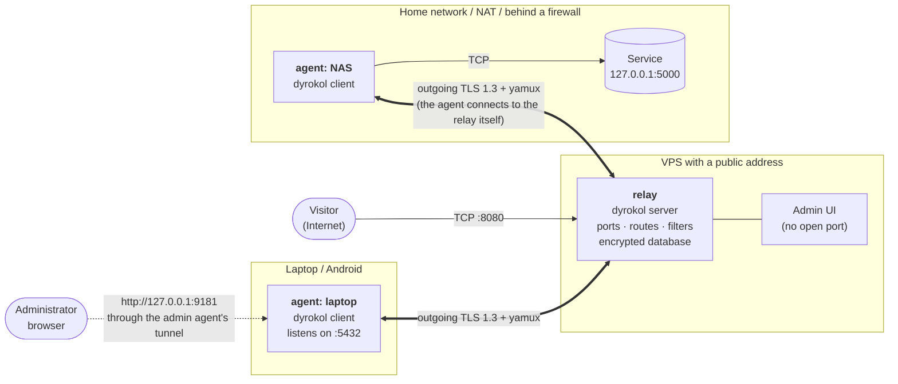

<div align="center">


# DyroKol

**Русский** | [English](#english)

[](LICENSE)
[](go.mod)
[-lightgrey.svg)](#сборки)

**Пробрасывает TCP-порты между вашими машинами через один публичный сервер**, без VPN,
без белых IP у домашних устройств и без ручной возни с `ssh -R`.


</div>

DyroKol («Hole Punch») — один бинарник на Go, который работает в двух ролях:

- **relay** (`dyrokol server`) — сервер с публичным адресом, например дешёвый VPS;
- **агент** (`dyrokol client`) — запускается на каждой вашей машине: NAS, домашний ПК,
  Raspberry Pi, Android в Termux.

Агенты сами подключаются к relay по TLS (исходящее соединение, поэтому NAT и фаервол не мешают).
Дальше вы управляете всем из веб-интерфейса: «порт 8080 на VPS → сервис `127.0.0.1:5000` на NAS».

## Как это работает



1. Агент **сам** открывает исходящее TLS-соединение к relay и держит его. Входящие порты на домашней
   машине открывать не нужно.
2. Relay знает всю конфигурацию: *входной порт → маршрут → выходная точка*. Он рассылает агентам
   только то, что им нужно, и мгновенно применяет любые изменения.
3. Посетитель приходит на входной порт (на relay или на агенте). Трафик идёт по туннелю до машины,
   которая исполняет выходную точку, и она подключается к цели (напрямую) или сама служит SOCKS5-выходом.

Подробнее: [Концепции](docs/ru/concepts.md) и [Архитектура](docs/ru/architecture.md).

## Возможности

- **Три сущности вместо правил:** *входной порт* (где трафик входит) → *маршрут* → *выходная точка*
  (где выходит). Любая комбинация: вход на relay или на агенте, выход на relay, на любом агенте
  или встроенный SOCKS5-выход.
- **Маршруты таблицей:** каждая строка — связка «вход → выход», правится на месте.
- **Схема маршрутов:** показывает, какие порты куда подключены и в каком они состоянии. Порты
  можно перетаскивать, добавлять текстовые подписи и рамки (они лежат под портами и линиями);
  раскладка сохраняется на сервере и общая для всех администраторов. Схему можно приближать,
  двигать и раскрывать на весь экран.
- **Фильтры allow/deny** на источник (кто может подключаться к порту) и на назначение
  (куда разрешено ходить выходной точке). `deny` всегда сильнее `allow`, при ошибке — fail closed.
- **Один порт — разные машины.** Номер порта уникален в пределах машины, а не глобально:
  `8080` может быть и на relay, и на NAS, и на ноутбуке.
- **Веб-интерфейс** (тёмная и светлая темы, мобильная вёрстка): обзор, машины, порты,
  живые соединения, адреса посетителей, графики трафика, журнал событий.
- **Управление без перезапусков.** Любое изменение сразу уходит на агентов.
- **Зашифрованная база.** Состояние relay лежит на диске только в виде шифротекста
  (AES-256-GCM, ключ из пароля через scrypt); на диск ничего не пишется открытым текстом.
- **Безопасный канал.** TLS 1.3, самоподписанный сертификат с проверкой отпечатка (pinning /
  trust-on-first-use), отдельные токены у каждой машины.
- **Админка не торчит наружу.** Она слушает только `127.0.0.1` и доступна администратору через
  тот же туннель.
- **Бэкап и восстановление** конфигурации одним JSON-файлом.
- **Служба одной командой.** Windows: `dyrokol service install` регистрирует приложение как службу;
  Linux: установка и systemd-юнит одной командой `install.sh`, плюс примеры для OpenRC, SysV и
  supervisor.
- **Одна статическая сборка** без зависимостей: Linux, Windows, Termux (Android), amd64/arm/arm64.

### Скриншоты

| Маршруты и схема | Машины |
| --- | --- |
|  |  |

| Входные порты | Настройки, бэкап |
| --- | --- |
|  |  |

Светлая тема и мобильная вёрстка тоже есть: [скриншот светлой темы](docs/img/overview-light.png).

## Быстрый старт

Нужны: машина с публичным адресом (relay) и любая машина, до которой хотите достучаться.

**0. Установка** (Linux; для Windows и Termux см. [Сборки](#сборки)):

```bash
curl -fsSL https://raw.githubusercontent.com/dnech/DyroKol/main/scripts/install.sh | sudo bash
```

**1. На VPS запустите relay**

```bash
dyrokol server
# dyrokol server listening on :7443 (tls pin sha256:…); database locked, waiting for an agent
```

Откройте TCP-порт `7443` в фаерволе VPS.

**2. На первой машине зарегистрируйтесь**

```bash
dyrokol client --server vps.example.com:7443
```

Команда создаёт базу на relay, выдаёт этой машине роль **admin**, сохраняет конфиг и подключается.
Она напечатает токены и адрес админки (`http://127.0.0.1:9181`) и в логе —
`admin ui token: …`.

**3. Откройте админку** на этой машине: `http://127.0.0.1:9181`, введите `admin ui token`.

**4. Пробросьте порт.** Ingress → *Add ingress port* → порт `8080` на `relay`; Egress → *Add egress port*
→ машина, хост `127.0.0.1`, порт вашего сервиса; затем на странице **Routes** подключите входной порт
к выходной точке (новая строка таблицы: `relay:8080` → ваш сервис). Готово: `http://vps.example.com:8080` ведёт на ваш сервис.

Подробный разбор с картинками — в [руководстве «Первые шаги»](docs/ru/getting-started.md).

## Запуск как службы

| Платформа | Как |
| --- | --- |
| **Windows** | В PowerShell от администратора: `dyrokol.exe service install client` (или `server`). Снять: `dyrokol.exe service uninstall`. Также `start`, `stop`, `restart`, `status`. |
| **Linux (systemd)** | `curl -fsSL …/install.sh \| sudo bash -s -- --role server` (или `client`) ставит бинарник и юнит. Ручные юниты, пользовательская служба, OpenRC, SysV, supervisor — в [Развёртывании](docs/ru/deployment.md#как-сделать-из-dyrokol-демон-службу). |
| **Android (Termux)** | Termux:Boot, см. [Развёртывание](docs/ru/deployment.md#android-termux). |

## Сборки

Бинарники **не хранятся в репозитории**: готовые файлы публикуются на странице
[Releases](https://github.com/dnech/DyroKol/releases) вместе с `SHA256SUMS`. Собрать самому:
`scripts/build.sh` (результат в `bin/`) или `scripts/release.sh` (файлы для релиза в `dist/`).

| Файл релиза | Платформа |
| --- | --- |
| `dyrokol-linux-amd64` | Linux x86-64 (VPS, ПК, NAS) |
| `dyrokol-linux-arm64` | Linux ARM64 (Raspberry Pi 4/5, серверы ARM) |
| `dyrokol-linux-arm` | Linux ARMv7 (32-битные платы) |
| `dyrokol-termux-arm64` | Android ARM64 в Termux |
| `dyrokol-termux-arm` | Android 32-bit ARM (ARMv7) в Termux |
| `dyrokol-windows-amd64.exe` | Windows x86-64 |
| `dyrokol-windows-arm64.exe` | Windows ARM64 |

## Документация

| Документ | О чём |
| --- | --- |
| [Первые шаги](docs/ru/getting-started.md) | Пошаговое руководство с типовыми сценариями |
| [Концепции](docs/ru/concepts.md) | Машины, порты, маршруты, фильтры, как идёт трафик |
| [Командная строка и конфигурация](docs/ru/cli.md) | Все команды, флаги, переменные окружения, файлы |
| [Админ-интерфейс](docs/ru/admin-ui.md) | Страницы и действия веб-интерфейса |
| [Развёртывание](docs/ru/deployment.md) | Установка, службы (systemd, Windows и др.), Termux, фаервол, обновление, бэкапы |
| [Безопасность](docs/ru/security.md) | Модель угроз, токены, шифрование, что не защищено |
| [Диагностика](docs/ru/troubleshooting.md) | Сообщения об ошибках и что с ними делать |
| [Архитектура](docs/ru/architecture.md) | Устройство, протокол, хранилище, инварианты |
| [HTTP API](docs/en/API.md) | Справочник по админ-API (только на английском) |
| [Разработка](docs/ru/development.md) | Сборка, тесты, стенд для UI, выпуск релиза |

Документация на английском: [docs/en](docs/en/getting-started.md).

## Аналоги

Похожие инструменты: frp, rathole, ngrok, Cloudflare Tunnel, Tailscale/WireGuard, chisel, bore, sshuttle, `ssh -R`. [Сравнение](docs/ru/alternatives.md) поможет понять, подходит ли DyroKol.

## Ограничения

- Только **TCP**. UDP не поддерживается.
- Каждый входной порт ведёт ровно в одну выходную точку. Обратное не ограничено: в одну выходную
  точку могут вести сколько угодно входных портов. Раздачи одного порта на несколько целей
  (балансировки) нет.
- Участок «посетитель → входной порт» не шифруется самим DyroKol: туннель между машинами
  защищён TLS, но если нужен TLS для посетителей, он должен быть в вашем сервисе.
- Relay видит весь трафик, который через него проходит. Размещайте его там, где вы ему доверяете.
- Служба (`dyrokol service`) встроена только в Windows-сборку; на Linux используйте systemd и
  другие способы из [Развёртывания](docs/ru/deployment.md).

## Участие и безопасность

Баги и идеи — в [Issues](https://github.com/dnech/DyroKol/issues). О найденной уязвимости сообщайте
приватно через [Security Advisories](https://github.com/dnech/DyroKol/security/advisories/new). Как
собирать и тестировать — в [Разработке](docs/ru/development.md).

## Лицензия

[MIT](LICENSE) © 2026 dnech. Встроенные библиотеки интерфейса (Preact, htm) распространяются под
собственными лицензиями: `internal/server/web/vendor/LICENSE-*`.

---

<a id="english"></a>

<div align="center">

[Русский](#dyrokol) | **English**

</div>

<div align="center">


# DyroKol

[](LICENSE)
[](go.mod)
[-lightgrey.svg)](#builds)

**Forwards TCP ports between your machines through a single public server**, with no VPN,
no public IPs on home devices and no fiddling with `ssh -R`.


</div>

DyroKol ("Hole Punch") is a single Go binary that works in two roles:

- **relay** (`dyrokol server`): a server with a public address, for example a cheap VPS;
- **agent** (`dyrokol client`): runs on each of your machines: a NAS, a home PC, a Raspberry Pi,
  an Android phone in Termux.

Agents connect to the relay over TLS themselves (an outgoing connection, so NAT and firewalls do not
interfere). From then on you manage everything from the web UI: "port 8080 on the VPS → the service
`127.0.0.1:5000` on the NAS".

## How it works



1. An agent **itself** opens an outgoing TLS connection to the relay and keeps it. No incoming ports
   need to be opened on the home machine.
2. The relay knows the whole configuration: *ingress port → route → egress port*. It sends agents only
   what they need and applies any change instantly.
3. A visitor arrives at an ingress port (on the relay or on an agent). The traffic goes through the
   tunnel to the machine that executes the egress port, and that machine connects to the target
   (directly, or acting as a built-in SOCKS5 exit).

More: [Concepts](docs/en/concepts.md) and [Architecture](docs/en/architecture.md).

## Features

- **Three entities instead of rules:** an *ingress port* (where traffic enters) → a *route* → an
  *egress port* (where it leaves). Any combination: entry on the relay or on an agent, exit on the relay,
  on any agent, or a built-in SOCKS5 exit.
- **Routes as a table:** each row is an "entrance → exit" link, edited in place.
- **Route diagram:** shows which ports are connected where and in what state. Ports can be dragged, and
  text labels and frames added (they lie under the ports and lines); the layout is saved on the server
  and shared by all administrators. The diagram can be zoomed, panned and expanded to full screen.
- **Allow/deny filters** on the source (who may connect to a port) and on the destination (where an
  egress port may go). `deny` always beats `allow`, and on error they fail closed.
- **One port number, different machines.** A port number is unique within a machine, not globally: `8080`
  can exist on the relay, on the NAS and on the laptop.
- **Web UI** (dark and light themes, mobile layout): overview, machines, ports, live connections,
  visitor addresses, traffic charts, an event log.
- **Management without restarts.** Any change goes to agents immediately.
- **Encrypted database.** The relay state lies on disk only as ciphertext (AES-256-GCM, key from a
  password via scrypt); nothing is written to disk in plaintext.
- **Secure channel.** TLS 1.3, a self-signed certificate with fingerprint verification (pinning /
  trust-on-first-use), a separate token for every machine.
- **The admin UI is not exposed.** It listens only on `127.0.0.1` and is reachable by the administrator
  through the same tunnel.
- **Backup and restore** of the configuration as one JSON file.
- **A service with one command.** Windows: `dyrokol service install` registers the application as a
  service; Linux: installation and a systemd unit with the single command `install.sh`, plus examples for
  OpenRC, SysV and supervisor.
- **One static build** with no dependencies: Linux, Windows, Termux (Android), amd64/arm/arm64.

### Screenshots

| Routes and diagram | Machines |
| --- | --- |
|  |  |

| Ingress ports | Settings, backup |
| --- | --- |
|  |  |

A light theme and a mobile layout exist too: [a light theme screenshot](docs/img/overview-light.png).

## Quick start

You need: a machine with a public address (the relay) and any machine you want to reach.

**0. Install** (Linux; for Windows and Termux see [Builds](#builds)):

```bash
curl -fsSL https://raw.githubusercontent.com/dnech/DyroKol/main/scripts/install.sh | sudo bash
```

**1. Start the relay on the VPS**

```bash
dyrokol server
# dyrokol server listening on :7443 (tls pin sha256:…); database locked, waiting for an agent
```

Open TCP port `7443` in the VPS firewall.

**2. Register on the first machine**

```bash
dyrokol client --server vps.example.com:7443
```

The command creates the database on the relay, gives this machine the **admin** role, saves the config
and connects. It prints the tokens and the admin UI address (`http://127.0.0.1:9181`), and the log shows
`admin ui token: …`.

**3. Open the admin UI** on this machine: `http://127.0.0.1:9181`, enter the `admin ui token`.

**4. Forward a port.** Ingress → *Add ingress port* → port `8080` on `relay`; Egress → *Add egress port* →
the machine, host `127.0.0.1`, your service's port; then on the **Routes** page connect the ingress port
to the egress port (a new table row: `relay:8080` → your service). Done: `http://vps.example.com:8080`
leads to your service.

A detailed walkthrough with pictures is in the [Getting started guide](docs/en/getting-started.md).

## Running as a service

| Platform | How |
| --- | --- |
| **Windows** | In PowerShell as administrator: `dyrokol.exe service install client` (or `server`). Remove: `dyrokol.exe service uninstall`. Also `start`, `stop`, `restart`, `status`. |
| **Linux (systemd)** | `curl -fsSL …/install.sh \| sudo bash -s -- --role server` (or `client`) installs the binary and the unit. Manual units, a user service, OpenRC, SysV, supervisor are in [Deployment](docs/en/deployment.md#making-dyrokol-a-daemon-service). |
| **Android (Termux)** | Termux:Boot, see [Deployment](docs/en/deployment.md#android-termux). |

## Builds

Binaries are **not stored in the repository**: ready files are published on the
[Releases](https://github.com/dnech/DyroKol/releases) page together with `SHA256SUMS`. To build them
yourself: `scripts/build.sh` (output in `bin/`) or `scripts/release.sh` (release files in `dist/`).

| Release file | Platform |
| --- | --- |
| `dyrokol-linux-amd64` | Linux x86-64 (VPS, PC, NAS) |
| `dyrokol-linux-arm64` | Linux ARM64 (Raspberry Pi 4/5, ARM servers) |
| `dyrokol-linux-arm` | Linux ARMv7 (32-bit boards) |
| `dyrokol-termux-arm64` | Android ARM64 in Termux |
| `dyrokol-termux-arm` | Android 32-bit ARM (ARMv7) in Termux |
| `dyrokol-windows-amd64.exe` | Windows x86-64 |
| `dyrokol-windows-arm64.exe` | Windows ARM64 |

## Documentation

| Document | What it covers |
| --- | --- |
| [Getting started](docs/en/getting-started.md) | A step-by-step guide with typical scenarios |
| [Concepts](docs/en/concepts.md) | Machines, ports, routes, filters, how traffic flows |
| [Command line and configuration](docs/en/cli.md) | All commands, flags, environment variables, files |
| [Admin UI](docs/en/admin-ui.md) | The pages and actions of the web UI |
| [Deployment](docs/en/deployment.md) | Installation, services (systemd, Windows and others), Termux, firewall, upgrades, backups |
| [Security](docs/en/security.md) | The threat model, tokens, encryption, what is not protected |
| [Troubleshooting](docs/en/troubleshooting.md) | Error messages and what to do about them |
| [Architecture](docs/en/architecture.md) | Design, protocol, storage, invariants |
| [HTTP API](docs/en/API.md) | The admin API reference |
| [Development](docs/en/development.md) | Building, tests, the UI rig, making a release |

Documentation in Russian: [docs/ru](docs/ru/getting-started.md).

## Alternatives

Similar tools: frp, rathole, ngrok, Cloudflare Tunnel, Tailscale/WireGuard, chisel, bore, sshuttle, `ssh -R`. See the [comparison](docs/en/alternatives.md) to decide whether DyroKol fits.

## Limitations

- **TCP** only. UDP is not supported.
- Each ingress port leads to exactly one egress port. The reverse is unlimited: any number of ingress ports
  can lead to one egress port. There is no distribution of one port across several targets (load balancing).
- The "visitor → ingress port" leg is not encrypted by DyroKol itself: the tunnel between machines is
  protected by TLS, but if visitors need TLS, it has to be in your service.
- The relay sees all the traffic that passes through it. Place it where you trust it.
- The service (`dyrokol service`) is built into the Windows build only; on Linux use systemd and the other
  methods from [Deployment](docs/en/deployment.md).

## Contributing and security

Bugs and ideas go to [Issues](https://github.com/dnech/DyroKol/issues). Report a vulnerability privately
through [Security Advisories](https://github.com/dnech/DyroKol/security/advisories/new). How to build and
test is in [Development](docs/en/development.md).

## License

[MIT](LICENSE) © 2026 dnech. The bundled UI libraries (Preact, htm) are distributed under their own
licenses: `internal/server/web/vendor/LICENSE-*`.
