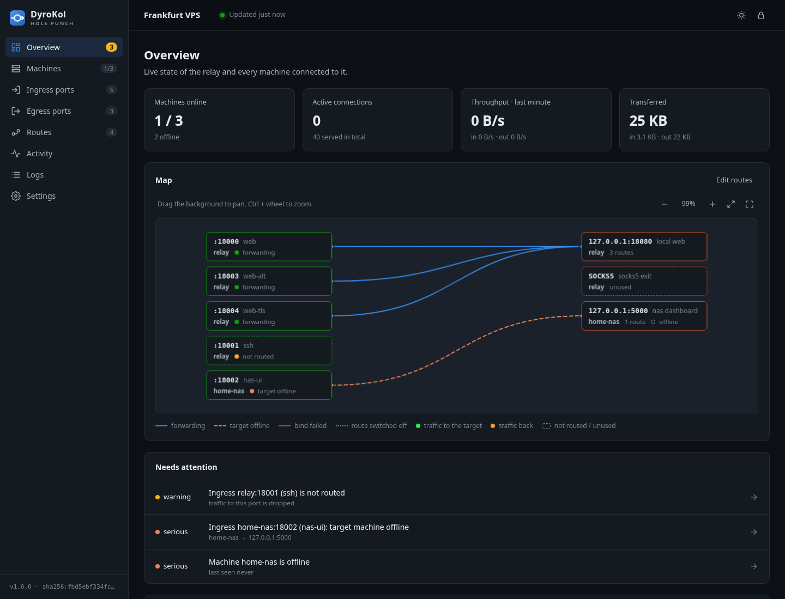
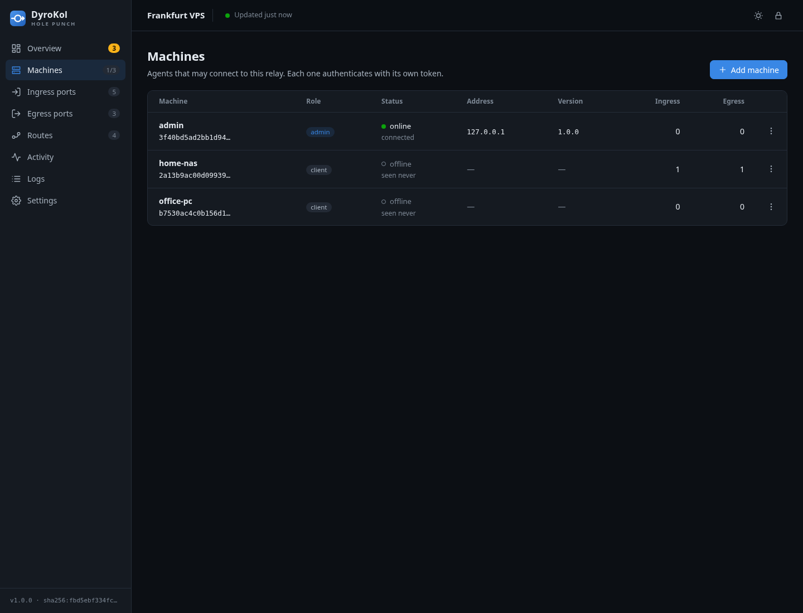
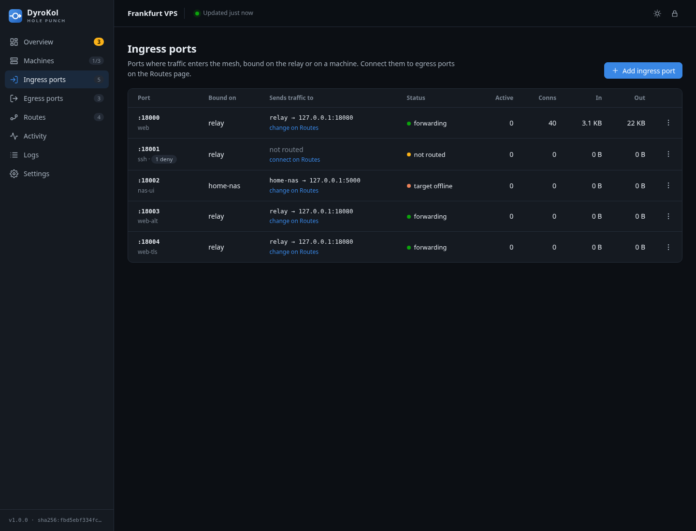
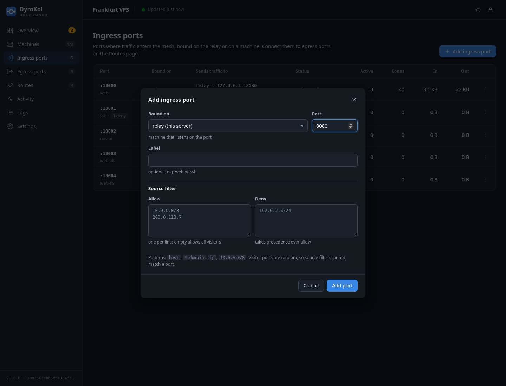
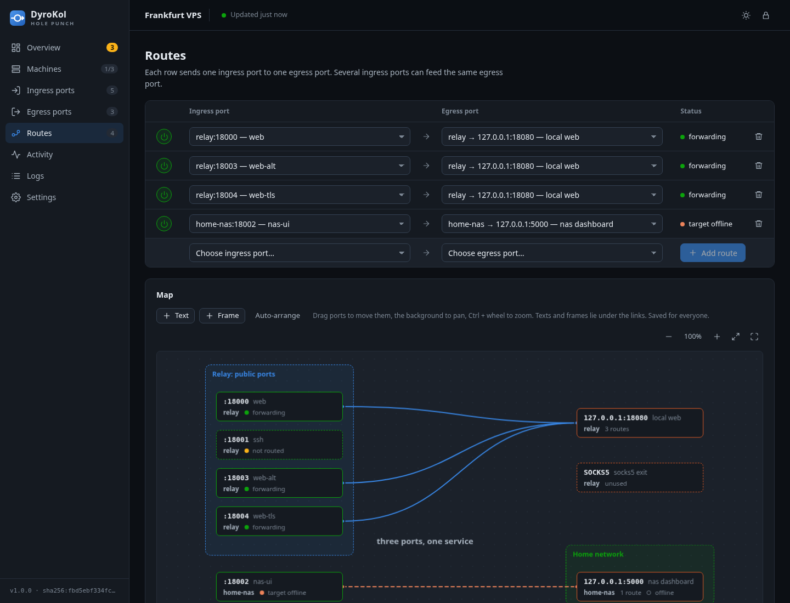
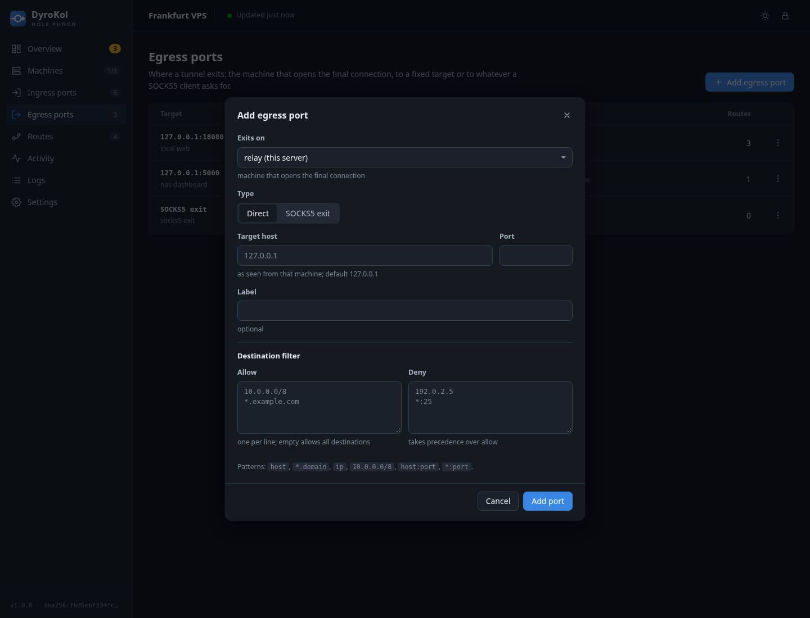
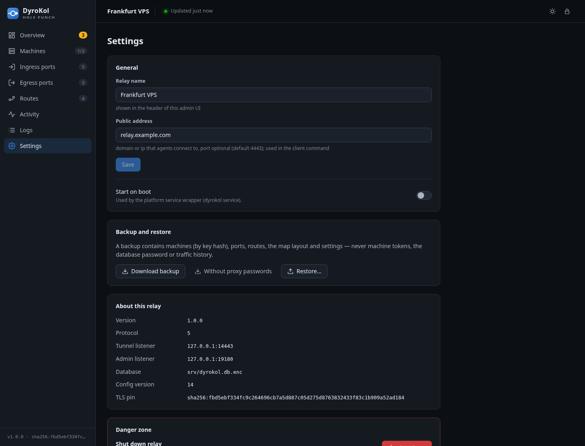

# Admin UI

The web interface is built into the relay binary and opens through an admin machine
(`http://127.0.0.1:9181` by default). It works without the Internet: all scripts and styles are
served by the relay itself.

## How to open it

The relay opens **no admin port** at all: the admin UI is served only to admin machines through their
tunnel. There are two ways in:

1. **Through the admin machine (the main way).** On a machine with the admin role the agent opens a
   local entrance: `http://127.0.0.1:9181` (the address can be changed with `--admin-listen`; with several relays in the client config each gets its own default port: 9181, 9182, … in config order). Traffic
   goes through the tunnel.
2. **Optional local entrance on the relay** (off by default): start the relay with `--admin 127.0.0.1:9180`
   (or `admin:` in its config) and forward it with `ssh -L 9180:127.0.0.1:9180 user@vps`, then open
   `http://127.0.0.1:9180` on your side.

The admin UI and the API appear **after the database is unlocked**, that is, once the first machine has
connected (after a relay restart, once a machine with the database password connects). Until then the
admin UI is unavailable.

## Signing in

The sign-in screen asks for the **admin API token**:

- the one generated by the relay (once, kept inside its encrypted database): the line `admin ui token: api_…` in the log of any admin machine;
- or the one you set with flags (`--token`, `--token-file`);
- or the `admin ui token` from the admin machine's log (the relay hands it over on connect).

This is not the machine's tunnel token. The token is kept in the tab's `sessionStorage` and disappears
when it is closed; the **Lock** button (the padlock in the top bar) wipes it immediately. A wrong token
shows an error, and when the token expires or changes the app returns to the sign-in screen by itself.

## General layout

- **Left menu**: eight sections in the order "entrance → exit → routes": Overview, Machines, Ingress
  ports, Egress ports, Routes, Activity, Logs, Settings. Badges: the number of problems on "Overview",
  online/total on "Machines", the count on the port pages.
- **The relay name** (Settings → Relay name) is shown at the left of the top bar when it is set.
- **The "Updated … ago" indicator** at the top: data refreshes every 5 seconds while the tab is visible
  (polling pauses in a background tab). Click to refresh now. If the relay is unreachable the
  indicator turns red ("Relay unreachable · retry").
- **Theme**: the sun/moon button switches between light and dark. The choice is remembered in the
  browser; without it the system theme is used.
- **Changes apply immediately**: after an action the UI refreshes, and success or failure is shown in a
  toast. Form errors (for example, "port already in use") are shown right in the dialog.
- **Keyboard**: `Esc` closes a dialog or menu; focus returns to the button you came from.
- **Mobile version**: the menu slides out with the hamburger button, tables scroll horizontally.

## Overview

- **Four indicators:** machines online, active connections, throughput over the last full minute, total
  transferred.
- **The "Throughput · last hour" chart:** inbound (visitor → target) and outbound (target → visitor)
  traffic per minute. Hover for a vertical line and a tooltip with values. The drop-down limits the
  chart to one port. The **Table** button shows the same data as a table.
- **Needs attention:** problems that lead to the right page on click:

  | Level | When |
  | --- | --- |
  | `critical` | a port could not be opened (bind failed) |
  | `warning` | a port has no route, traffic is dropped |
  | `serious` | the route's target machine is offline; a machine with ports is offline |

- **Map:** the route diagram as you arranged it on the Routes page (view only).

## Machines

The machine table: name and key prefix, role, status (online / when last seen), address of the last
connection, agent version, number of ingress and egress ports.

| Action (⋮ menu) | What it does |
| --- | --- |
| **Add machine** (top button) | Creates a machine, shows its token **once** and a ready-to-use agent launch command (the command contains `--db-password` only for the `Admin` role: the password is needed just to unlock the relay after a restart). |
| Rename | Changes the label. |
| Promote to admin / Demote to client | Changes the role; the machine reconnects. The last admin cannot be demoted. |
| Regenerate token | Issues a new token (with the prefix of the machine's current role: `adm_` for admin machines, `cl_` for the others); the old one stops working at once and the machine is disconnected. The machine's ports and egress ports are kept. |
| Delete | Deletes the machine **together with its ports, egress ports and their routes.** |

## Ingress ports

The table: port and label (plus a filter icon if one is set), owner machine, route target (display only,
linking to the **Routes** page), status, active connections, total connections, inbound and outbound
bytes. Routes are not edited here: there is a separate page for that.

Statuses: `forwarding` (working), `not routed` (no route), `target offline` (the target machine is not
online), `bind failed` (the port did not open; the reason is under the status, the row is highlighted).

The **Add ingress port** dialog (and **Edit**):

| Field | Description |
| --- | --- |
| Bound on | The machine where the port opens (at creation only) |
| Port | A number 1–65535, unique within the machine. **The number can be changed on an existing port too** |
| Label | A label |
| Source filter | Allow/deny lists for visitors. Ports are not allowed in entries |

A relay port opens instantly; if it is busy on the relay host, creation is rejected with an error.
When the number of a relay port changes, the old socket is closed and a new one opened; if the new
number could not be bound, the change is rolled back and an error is shown (the port keeps working on
its old number). For an agent port the new number applies on the next configuration delivery. An agent
port opens on the next configuration delivery, and on failure the `bind failed` status appears in the
table. The ⋮ menu: **Edit**, **Routes…** (go to the routes page), **Delete** (closes the port and its
active connections). Routes are not edited on this page.

## Routes

The page consists of the **route table** (top) and the **diagram** (below it).

### The table

**One row is one route: "ingress port → egress port".** Rows are edited in place:

- the round **on/off button** at the start of the row switches the route: **green** is on, **red** is
  off. A switched-off route stays in the table (nothing is lost) but carries no traffic: its ingress
  port behaves as if it had no route, active connections are closed, and agent-side ports are
  released. The status reads `route off` and the line on the diagram turns grey and dotted;
- next you pick the ingress port (the list holds the row's own port and the ingress ports that
  have no route yet), on the right the egress port; changing either is saved at once;
- on the right are the state (`forwarding`, `target offline`, `bind failed`, `route off`) and a trash button that
  deletes the route (the port's active connections are closed);
- the last row (highlighted) is a **new route**: pick an ingress port without a route and an egress
  port and click **Add route**.

Several ingress ports to one egress port are just several rows with the same egress port; rows are
sorted by egress port so such a group stays together. Each ingress port has one route, so the same
ingress port cannot be in two rows (it disappears from the lists as soon as it gets a route).

### The diagram

A reference picture of what is configured in the table. Every port is a node (number, label, machine and
state are visible), a route is a line. Hover a port to highlight everything connected to it. The state
is always labelled with a word, not only a colour:

| Element | Meaning |
| --- | --- |
| blue line | `forwarding`: traffic flows |
| orange dashed line | `target offline`: the target machine is not online |
| red line | `bind failed`: the port could not be opened |
| node with a dashed border | `not routed` (ingress) or `unused` (egress): nothing is connected to it |

**Traffic animation.** Dots travel along a route line: green ones from the ingress to the egress port, bright orange ones back. More traffic (a moving average over the last polls) means more dots moving faster; when traffic stops the dots keep moving and fade out smoothly (in roughly 5–10 seconds). They are hidden when the system asks for reduced motion.

**The diagram can be zoomed, panned and expanded to full screen** (on the Routes page and on Overview).
The controls are at the top right of the diagram: **− / 100% / +** (clicking the percentage returns to
100%), **Fit** (fit all content into the window) and **Full screen**:

- **Pan:** drag the empty background (same with a finger; a two-finger pinch zooms).
- **Zoom:** the − and + buttons, or **Ctrl (⌘) + wheel** (a pinch on a touchpad). The plain wheel
  scrolls the page, and in full-screen mode zooms the diagram. The range is 20–300 %.
- **Full screen** expands the diagram to the whole window and turns on the browser's full-screen mode.
  Exit with the button there or the `Esc` key (dialogs, such as Auto-arrange, open over the diagram,
  and the first `Esc` closes the dialog). Editing works in full screen as well.
- The view position and zoom are remembered only in the browser and are not saved on the server (unlike
  the placement of ports, frames and labels).

**You can arrange the diagram as you like:**

- **Drag ports** with the mouse or a finger: the position is remembered. The grid step is 10 pixels, and
  at any zoom the port follows the cursor exactly.
- **Text** adds a text label, **Frame** a frame (for example, "Home network" around the ports at home).
  Select an element to change the text, the colour (6 colours) and the label size (S/M/L), drag a frame's
  corner (it resizes) or delete it with the **Delete** button or the `Delete` key. They move the same
  way, by dragging.
- **Layers:** from bottom to top come frames, labels, lines and ports. Labels and frames never cover
  ports or lines.
- **Auto-arrange** puts the ports back in their default places (the left column ingress, the right
  egress); frames and labels stay.
- Ports you have not yet placed (for example, new ones) fall into their column below those already placed.

The layout is **shared by all administrators** and saved on the relay automatically (half a second after
the last change); it is part of the configuration backup. The same arranged ports are shown on the
**Overview** page (the diagram there is view only). On a narrow screen the diagram can be panned and
zoomed in the same way.

## Egress ports

The egress table: target, executing machine, type, machine status, the
number of routes leading here.

Fields: *Exits on* (machine), *Type* (Direct/SOCKS5), *Target host* (`127.0.0.1` by default, **from the
executing machine's point of view**) and *Port*; for SOCKS5 there is no target: only an optional login and password for the built-in SOCKS5
server; a label and a *Destination filter* (ports are allowed there: `*:25`, `host:443`).

When editing you can change the **target (host and port, direct only), the SOCKS5 login, the label and the filter**.
The machine and type are fixed: to move an egress port to another machine or change its type, create a
new one, move the routes to it (it is enough to change the egress port in the Routes table rows) and
delete the old one. Two identical egress ports cannot be made (the machine, type and target
match). The new target applies to new connections; ones already open continue to the old one. When an
egress port is deleted, the ports leading to it become unrouted and their active connections are closed.

## Activity

Two tabs with a shared search (by address, port, name):

- **Live connections**: connections open right now: the visitor's address, the port (`machine:port`),
  which machine serves it, how long the connection has been open. Refreshes every 3 seconds (up to 500
  connections per agent are shown).
- **Seen addresses**: visitor addresses over the last 24 hours: number of connections, bytes, first and
  last appearance.

## Logs

Relay events for 7 days: database initialization and unlock, machines connecting and disconnecting, bind
errors, rejected handshakes, rejected configurations, restore from a backup. Filter by level (`info`,
`warn`, `error`) and text search; the last 1000 entries are shown.

## Settings

- **Relay name**: the display name of this relay. It is shown in the top bar of the admin UI (and in the
  browser tab title), which helps when you manage several relays.
- **Public address**: the domain or IP that agents connect to, with an optional port (default `7443`),
  for example `relay.example.com`. It is stored in the database and only fills in the agent launch
  command of the **Add machine** dialog; the relay itself does not use it.
- **Start on boot**: a flag stored in the database; by itself it starts nothing. Autostart is configured
  by the OS service: `dyrokol service install` on Windows, systemd on Linux (see
  [Deployment](deployment.md)).
- **Backup and restore.**
  *Download backup* downloads `dyrokol-config.json`, *Without proxy passwords* the same without SOCKS5
  passwords (the file is safe to show to others). *Restore…* replaces the **whole** configuration from a
  file, disconnects all agents (they reconnect) and clears the statistics. The backup also includes the
  placement of ports on the diagram with frames and labels. Machine tokens, the database password and
  traffic history are not included.
- **About this relay**: version, protocol version, addresses, database file, configuration version, the
  TLS certificate fingerprint (agents compare it on first connection).
- **Danger zone → Shut down**: stops the relay process. It has to be started again on the host itself;
  naturally, the admin UI stops responding after that.
