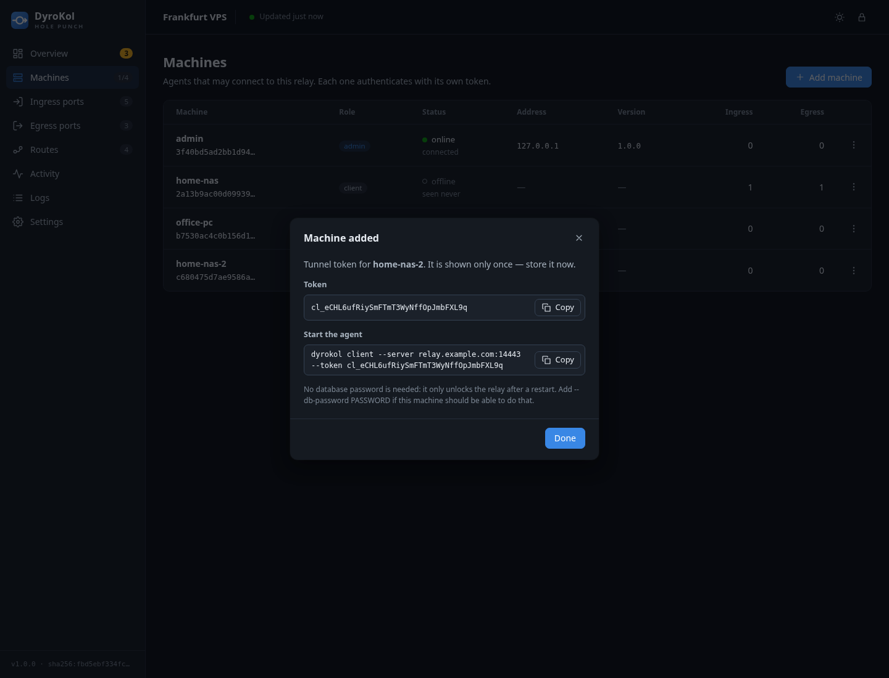

# Первые шаги

Это руководство проведёт от пустой машины до работающего проброса порта и разберёт три типовых
сценария. Термины («машина», «входной порт», «выходная точка») объяснены в
[Концепциях](concepts.md).

## Что понадобится

- **Relay**: машина с публичным IP или доменом, на которой можно открыть TCP-порт `7443`.
  Подойдёт самый дешёвый VPS.
- **Хотя бы одна машина-агент**: любой компьютер или устройство с выходом в интернет.
- Бинарник `dyrokol` под нужную платформу (см. [таблицу в README](../../README.md#сборки)).

Дальше предполагается, что relay доступен по адресу `vps.example.com`.

## 1. Запуск relay

На VPS:

```bash
chmod +x dyrokol
./dyrokol server
```

Вы увидите:

```
server: created default config /root/.config/dyrokol/dyrokol-server.yaml
dyrokol server listening on :7443 (tls pin sha256:454c8c0b…); database locked, waiting for an agent
```

Что произошло:

- создан конфиг, самоподписанный TLS-сертификат и ключ (в `~/.config/dyrokol`);
- relay слушает туннельный порт `:7443`;
- **база данных ещё не существует и заблокирована**: админка и порты появятся, когда подключится
  первая машина;
- сгенерирован токен админ-API (если вы не задали свой — см. [CLI](cli.md#relay-dyrokol-server)).

Откройте TCP-порт `7443` на VPS (фаервол провайдера и `ufw`/`iptables`). Админку наружу
открывать **не нужно**: она слушает только `127.0.0.1`.

Для постоянной работы настройте службу — см. [Развёртывание](deployment.md#systemd-relay).

## 2. Первая машина: регистрация

На машине, с которой вы будете управлять сетью (обычно ноутбук или домашний сервер):

```bash
./dyrokol client --server vps.example.com:7443
```

Вывод:

```
Machine registered on vps.example.com:7443.

  tunnel token:  adm_…
  db password:   …
  config:        /home/me/.config/dyrokol/dyrokol.yaml
  admin ui:      http://127.0.0.1:9181 (this machine holds the admin role)
…
2026/10/17 03:09:45 [vps.example.com:7443] admin ui available at http://127.0.0.1:9181
2026/10/17 03:09:45 [vps.example.com:7443] admin ui token: api_…
2026/10/17 03:09:45 [vps.example.com:7443] connected, role=admin
```

Что произошло:

1. Агент сгенерировал токен и пароль базы и отправил их relay.
2. Relay создал зашифрованную базу с одной машиной — этой — в роли **admin**.
3. Токен и пароль сохранены в конфиг агента (`dyrokol.yaml`, права `0600`).
   **Токен и пароль показываются один раз**, но остаются в конфиге.
4. Агент подключился и открыл на своём `127.0.0.1:9181` вход в админку.
5. Отпечаток сертификата relay запомнен в `pins.json` (trust-on-first-use): дальше подключиться
   к подменённому серверу не получится.

> **Проверьте отпечаток.** Первое подключение доверяет сертификату вслепую. Сверьте строку
> `tls pin` из лога relay с `pins.json` на агенте, если сеть между вами ненадёжна. Или передайте
> отпечаток заранее: `--tls-pin sha256:…`.

В следующие разы запускайте просто `./dyrokol client`: конфиг уже есть.

## 3. Вход в админку

Откройте `http://127.0.0.1:9181` **на этой же машине** и вставьте `admin ui token` из лога агента
(начинается с `api_`).

Это токен админ-API, а не токен туннеля. Relay генерирует его один раз при первом запуске и хранит внутри своей
зашифрованной базы (не в конфиге и не в логе), поэтому он не меняется при перезапусках; админ-машина получает его при каждом
подключении и печатает как `admin ui token`.


На странице **Overview** сразу видно, что требует внимания: «Needs attention» подсказывает
следующие шаги (порт без маршрута, офлайн-машина, ошибка bind).

## Сценарий A. Выставить сервис с домашней машины в интернет

*Задача:* веб-сервис на NAS (`127.0.0.1:5000`) должен открываться по `http://vps.example.com:8080`.

### A1. Добавьте NAS как машину

**Machines → Add machine**, метка `home-nas`, роль `Client`. Откроется диалог с токеном:



Скопируйте токен (он больше не покажется) и команду запуска. На NAS:

```bash
./dyrokol client --server vps.example.com:7443 --token cl_…
```

Пароль базы здесь не нужен: он лишь разблокирует relay после перезапуска, и первая подключившаяся с ним
машина делает это за всех. Дайте его (`--db-password <пароль>`) админ-машине и, при желании, одной всегда
включённой машине; остальные подождут, пока relay разблокируют, и подключатся. Команда в диалоге
**Add machine** содержит `--db-password` только для роли `Admin`.

Эта форма запуска ничего не сохраняет. Чтобы агент запускался просто как `./dyrokol client`,
положите конфиг:

```yaml
# ~/.config/dyrokol/dyrokol.yaml
servers:
  - addr: vps.example.com:7443
    token: cl_…
    db_password: …      # нужен только если relay может оказаться заблокированным, см. ниже
```

> **Зачем пароль базы.** После перезапуска relay база заблокирована, пока кто-то не предъявит
> пароль. Его хранит админ-машина (он сохранён в её конфиге), поэтому relay разблокируется, как
> только она подключится. Если админ-машина может быть выключена, добавьте пароль и в конфиги
> других агентов. Подробности — в [Безопасности](security.md#пароль-базы).

В списке машин `home-nas` станет **online**.

### A2. Выходная точка на NAS

**Egress ports → Add egress port**:


- *Exits on*: `home-nas`
- *Type*: Direct
- *Target host*: `127.0.0.1` (это адрес **с точки зрения NAS**), *Port*: `5000`
- *Label*: `nas dashboard`

### A3. Входной порт на relay

**Ingress ports → Add ingress port**:


- *Bound on*: `relay (this server)`, *Port*: `8080`

Нажмите **Add port**. Порт создан, но пока никуда не ведёт: на странице Ingress у него статус
`not routed`, а на обзоре он подсвечен как проблема.

### A4. Маршрут

Откройте **Routes**. В последней строке таблицы (**новый маршрут**) выберите слева входной порт
`relay:8080`, справа выходной `home-nas → 127.0.0.1:5000` и нажмите **Add route**.


В таблице появилась строка `relay:8080 → home-nas`, а на схеме ниже линия между этими портами.
Откройте `http://vps.example.com:8080`: вы попадёте на NAS. Откройте порт `8080` в фаерволе VPS,
если он закрыт.

Строка порта на странице Ingress показывает статус `forwarding`, счётчики и цель.


**Нужны ещё входы на тот же сервис?** Добавьте порты (например, `80` и `443`), а затем в таблице
Routes добавьте для каждого свою строку с тем же выходным портом: в одну выходную точку может вести
сколько угодно входных портов.

**Схему под таблицей можно расставить как удобно:** перетащите порты, добавьте рамку «Дом» вокруг
домашних машин и подпись «Интернет»: расположение запомнится и будет таким же у всех
администраторов.

### Ограничить, кто может зайти

В диалоге порта (**⋮ → Edit**) в блоке *Source filter* добавьте, например, `allow: 203.0.113.0/24`.
Остальные посетители будут отброшены. Порты в фильтре источника указывать нельзя.

## Сценарий B. Достать удалённый сервис на свой ноутбук

*Задача:* на ноутбуке открыть `localhost:5432`, и попасть в PostgreSQL, который работает на NAS.

1. Подключите ноутбук как машину `laptop` (как в A1) или используйте админ-машину.
2. Выходная точка: машина `home-nas`, хост `127.0.0.1`, порт `5432`.
3. Входной порт: *Bound on* `laptop`, порт `5432`. Затем на странице **Routes** подключите его к этой точке.

Агент на ноутбуке откроет порт `5432`; соединения пойдут через relay на NAS
(случай 4 из [Концепций](concepts.md#как-идёт-трафик)). Чтобы порт был доступен только с самого
ноутбука, а не из локальной сети, добавьте в фильтр источника `allow: 127.0.0.1`.

## Сценарий C. Выходить в сеть через SOCKS5-выход

*Задача:* внешняя программа с поддержкой SOCKS5 должна выходить в сеть с домашней машины.

1. Выходная точка: машина `home-nas`, тип **SOCKS5 exit** (без хоста и порта; при желании логин и
   пароль).
2. Входной порт на relay; на странице **Routes** подключите его к этой точке.
3. Направьте любую SOCKS5-программу на входной порт (`relay:PORT`).

SOCKS5-сервер встроен в агент `home-nas`: он сам открывает с `home-nas` все исходящие соединения,
которые просит клиент. Ограничьте цели фильтром назначения (`allow: example.com`), если точка не
должна ходить куда попало.

## Что дальше

- Все страницы интерфейса: [Админ-интерфейс](admin-ui.md).
- Запуск как службы, фаервол, обновление: [Развёртывание](deployment.md).
- Если что-то не работает: [Диагностика](troubleshooting.md).
